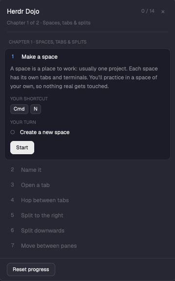

# Herdr Dojo

Learn [Herdr](https://herdr.dev) by doing it. A small floating window gives you short lessons; each one asks for a real action (make a space, open a tab, split a pane, zoom…) and checks itself off the moment Herdr's own state shows you did it. The shortcuts it teaches come from your own `keys.json`.



14 short lessons in two chapters: *Spaces, tabs & splits* and *Around the app* (names, agents, the picker).

## Install

Ask your agent: "Read ~/.config/herdr-app/AGENTS.md, then add this mod: `mods/dojo` from this repo", or copy the folder to `~/.config/herdr-app/mods/dojo/` yourself and run:

```sh
herdr-app check ~/.config/herdr-app/mods/dojo
```

Open it with `mod.open:dojo` from the command palette, or bind a key in `keys.json`:

```json
{ "global": { "cmd-shift-j": "mod.open:dojo" } }
```

## Good to know

- Lesson 1 makes a **practice space**; the other lessons only touch that one. The `Close practice space` button removes it when you're done.
- Progress is stored in the mod's `localStorage`. `Reset progress` clears it.
- Nothing is sent anywhere; the mod only reads Herdr's local state.

## Files

- `mods/dojo/main.js`: the window.
- `mods/dojo/lessons.js`: the lessons, as data (add your own: each has `steps` with a `test(start, now)` over Herdr's state).
- `RECIPE.md`: a brief another agent can rebuild the mod from.
