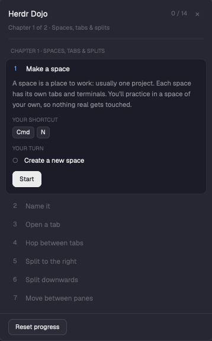

# Herdr Dojo

A floating practice window that teaches Herdr by making you do it. 40 short lessons in 8 chapters. Each asks for one real action (make a space, split a pane, pin an agent, add a worktree…) and ticks itself off the moment Herdr's own state shows you did it. The shortcuts it shows are read from *your* `keys.json`, so it teaches the keys you actually have. English and Spanish.

## What you see

A 400 × 680 px window (draggable, over the layout, not modal), three parts top to bottom:

- **Header** (flex-none): `Herdr Dojo` in 15px bold; at the right `done / total` (11.5px `dim`), an `EN`/`ES` chip (20px high, 1px `border`, toggles the language) and a `×` that closes the window. Below: `Chapter N of 8 · <title>` for the first unfinished lesson, a 4px progress bar (`raised` track, `accent` fill), and, once earned, gold `★ trophy` pills (18px high, `raised`, `#e3b341` text).
- **Lesson list** (scrolls): eight chapter headers (`▾`/`▸`, `CHAPTER N · TITLE`, `done/total` at the right, 10.5px). Only the open chapter shows its lesson cards; clicking a header folds or opens it. The chapter of the current lesson opens by itself.
- **Footer** (flex-none, top border): `Practice`, `Clean up`, `Reset progress` buttons (30px high, wrap onto a second row if narrow). With everything done it also says `All chapters complete · <total time> in total`.

A lesson card shows a mark (number; `✓` green when done; `●` gold or silver for a medal; `–` skipped), the title, and the best time. The open card adds: the lesson text (12.5px `muted`); `YOUR SHORTCUT` with one keycap per key (22px, `raised`, 1px `border`, radius 6); `YOUR TURN` with a checklist (`○` pulsing while waiting, `✓` green); revealed hints under `HINT` (amber); buttons.

## Curriculum (ids in `lessons.js`)

1. **Spaces, tabs & splits**: new-space, rename-space, new-tab, switch-tab, split-right, split-down, move-focus, zoom (2 steps), close-pane, switch-space (2 steps), palette (manual).
2. **Around the app**: rename-tab, picker (manual), search (manual).
3. **Agents**: start-agent, agent-working, agent-blocked, agent-answer (2 steps), agent-pin, cycle-agents (skipped when fewer than 2 agents), agent-stop.
4. **Worktrees**: wt-sandbox, wt-new, wt-look (manual), wt-remove.
5. **Make it yours**: theme (2 steps), zoom-app (2 steps), layout-switch (manual), sidebar (manual), bind-key, settings (manual).
6. **Organize your work**: swap, move-tab, settle (2 steps), move-space.
7. **Other machines**: machine-add (skippable), machine-space (skipped when no machine).
8. **Your own mods**: mod-clone, mod-look (manual), mod-remove.

## How it behaves

- **Start:** clicking a lesson (or `Start`, `Next lesson →`) prepares what it needs, snapshots Herdr's state, and begins. Lessons unlock in order; done ones can be replayed.
- **Practice space:** lesson 1 creates a space and remembers its id. Lessons that need one select it first, add the tabs, panes or spaces they require (`minTabs`, `minPanes`, `minSpaces`) and start once the state matches (2.5 s at most).
- **Detection:** a 400 ms timer reads `spaces()`, `panes()`, `focused()`, `agents()`, `settings()`, `theme()`, `keys()`, `machines()` and compares with the snapshot. Steps tick in order. Nothing listens to keystrokes, so mouse, key or `Do it for me` all count.
- **Persistence:** progress and the lesson in progress (with its snapshot) live in `localStorage` key `dojo.v2`, so a half-done lesson survives closing the window, even a layout switch. Progress from version 1 (`dojo.v1`) is imported once.
- **Practice agent (chapter 3):** `mods/dojo/demo-agent.sh` is a POSIX script that writes Herdr's status sequence (`ESC ] 7501 ; state=<idle|working|blocked|done|clear> : app=dojo-agent [: kind=… : msg=<base64>] ESC \`) and sleeps; no model, no network. Enter gives it a task: working 6 s, blocked asking permission, Enter, working 4 s, done. It is started with `tab.new {space, name: "Practice agent", argv: ["sh", "<config>/mods/dojo/demo-agent.sh"]}`. Needs `sh`, so macOS or Linux.
- **Scratch repo (chapter 4):** the Dojo makes `<config>/data/dojo/scratch-repo` with `git init` and one commit (`user.name=Dojo`, `commit.gpgsign=false`), opens a space on it, and the worktree lessons use that space only. A worktree is made with `openOverlay({mod: "worktree", kind: "dialog", props: {space, action: "new", branch: "dojo-demo"}})`. Worktree spaces are recognised by a folder containing `/worktrees/`.
- **Medals:** each lesson has a `goal` in seconds. Done in time without help: gold `●`; within double: silver; otherwise `✓`. Using `Hint` or `Do it for me` (not a lesson's `primary` button) counts as help. The best medal and time are kept.
- **Hints:** `Hint` reveals the lesson's tips one by one.
- **Practice:** picks a random finished, detectable lesson and replays it.
- **Trophies:** First steps (1 lesson), Self-taught (10 without help), Quick hands (5 gold), one per finished chapter, Dojo master (all 40).
- **Skip:** shown when a lesson can't be done on this setup (`skip(state)` returns the reason) or is `skippable`; stored as `skipped`.
- **Manual lessons:** things Herdr can't show (palette, search, picker, layout switch…) have a button such as `I opened it`.
- **Clean up** (two clicks): closes the practice space, the scratch-repo space and any `/worktrees/scratch-repo` worktrees (`git worktree remove --force`), deletes `data/dojo/scratch-repo` and `mods/dojo-practice`.
- **Shortcuts shown:** for each lesson's command it reads `keys()`, the global binding first, and splits the combo into keycaps (`cmd-shift-]` → `Cmd` `Shift` `]`); with no binding it says so.
- **Language:** the chip switches `ES.lessons[id]` (title, teach, steps, hints, button labels) over the English text; anything missing falls back to English.

## Built from

- `mods/dojo/mod.json`: `{ "place": "none", "title": "Herdr Dojo", "overlay": { "kind": "window", "width": 400, "height": 680 } }`.
- `main.js`: one `View` (`Dojo`): `init` loads the store and starts `cx.timer.every(400, …)`; `start`, `tick`, `finish`, `cleanup`, `makeSandbox`, `trophies`; `render` builds header, chapters, cards and footer with `v_flex`/`h_flex`/`div`. Uses from `herdr`: `spaces`, `panes`, `focused`, `agents`, `machines`, `keys`, `theme`, `settings`, `run`, `props`, `closeOverlay`, `openOverlay`, `appHome`, `exec`; and `fs/promises` (mkdir, writeFile under the config folder).
- `lessons.js`: the curriculum as data (see the header comment: `steps[{text,test(start,now)}]`, `want`, `goal`, `hints`, `doit(api,state,step,start)`, `primary`, `manual`, `needs*`, `skip`).
- `es.js`: Spanish for every lesson, chapter and UI string.
- `demo-agent.sh`: the practice agent.
- Commands used: `space.new`, `space.select`, `space.rename`, `space.move`, `space.next`, `space.close`, `tab.new`, `tab.next`, `tab.rename`, `tab.move`, `tab.settle`, `tab.unsettle`, `pane.split`, `pane.go`, `pane.swap`, `pane.zoom`, `pane.close`, `agent.focus`, `agent.next`, `terminal.pin`, `terminal.kill`, `terminal.search`, `app.theme`, `app.zoom_in`, `app.zoom_reset`, `app.palette`, `app.settings`, `layout.switch`, `layout.toggle`, `mod.open`, `mod.clone`.
- Open it with `mod.open:dojo`: the repo's `keys.json` snippet adds `"cmd-shift-j": "mod.open:dojo"` under `global`; merge it into yours, don't replace the file. Press it again to close.
- Colors are theme names only (plus gold `#e3b341` and silver `#aab4c2` for medals).

## Watch out

- **It really creates things.** Practice space, tabs, panes, a practice agent, a scratch repo and a worktree are real. Everything is under its own names and `Clean up` removes it. The Dojo never touches a space it did not make, and the worktree lessons never use your repos.
- **State, not keystrokes.** A test passes when the state changed since the snapshot, so it can't tell *how*; `Do it for me` counts (but costs the medal).
- **Layout switches close floating windows.** The `layout-switch` lesson says so; reopen with the key and the lesson is still in progress.
- **Zoom detection** compares `JSON.stringify(settings())`; the theme lesson compares `theme()` background, foreground and accent.
- **Chapter 3 needs `sh`.** On Windows those lessons can be skipped.
- **`mod-remove` runs `rm -rf <config>/mods/dojo-practice`**: a fixed path, nothing else.
- **Don't rename `dojo.v2`** if you want progress to survive an update.
- It shows `Cmd`, `Ctrl`, `Alt`, `Shift` as words on every OS.

## Done when

1. `herdr-app check mods/dojo` passes and `node tests/lessons.test.mjs` prints `all passed`.
2. `mod.open:dojo` opens a window with 8 chapter headers, the first open, lesson 1 expanded, and `0 / 40` for a new person.
3. Lesson 1 shows the keycaps for the key bound to `space.new`; unbind it and it shows the `No key is bound` text.
4. `Start`, then making a space ticks the step within about half a second, prints `Done in …`, and `Next lesson →` starts lesson 2 in that space.
5. Chapter 3: `Start practice agent` opens a tab; pressing Enter in it ticks `working`, then `blocked` shows after about 6 s; Enter again ends at `done`.
6. Chapter 4: starting a lesson opens the `Dojo repo` space; `Make one for me` adds a nested worktree space and the lesson ticks.
7. The `EN`/`ES` chip switches every visible text. `Clean up` and `Reset progress` need two clicks each.
